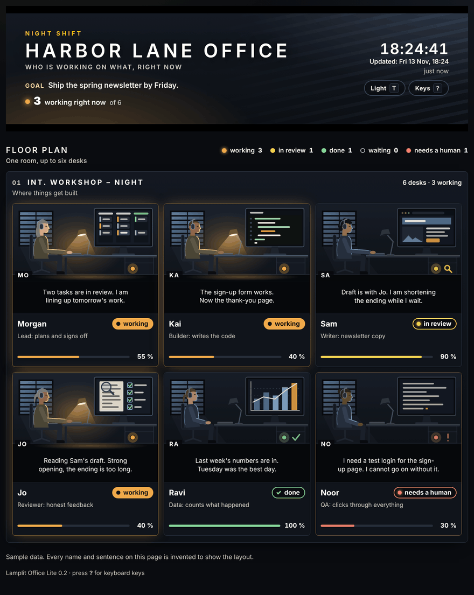
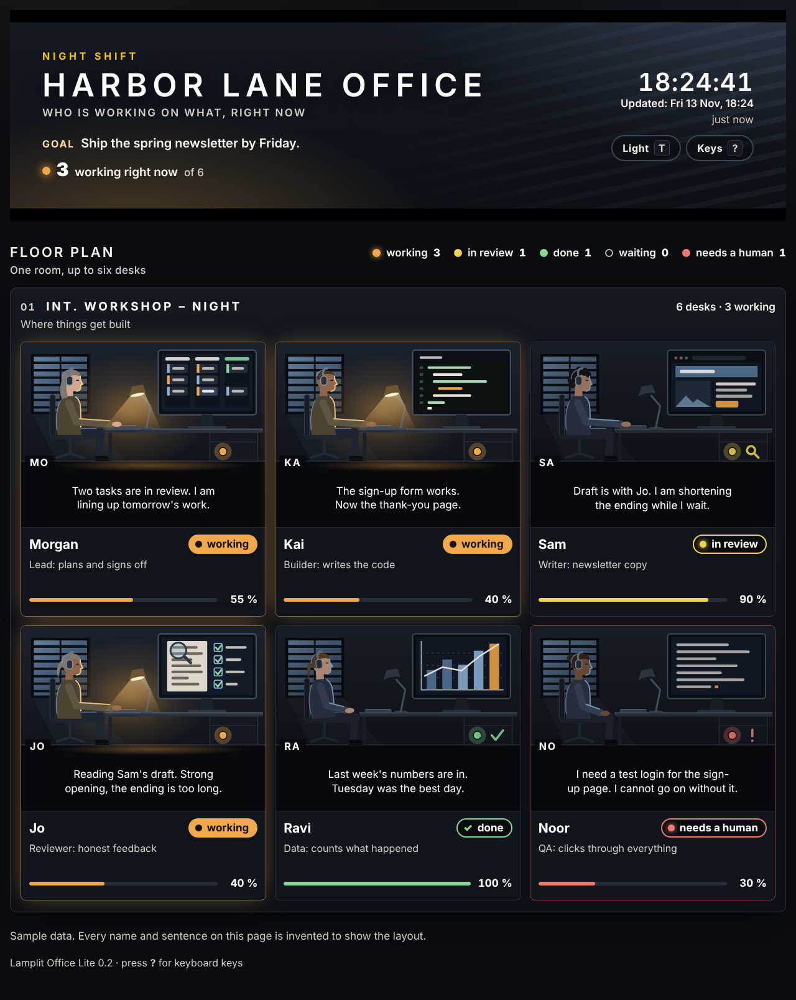
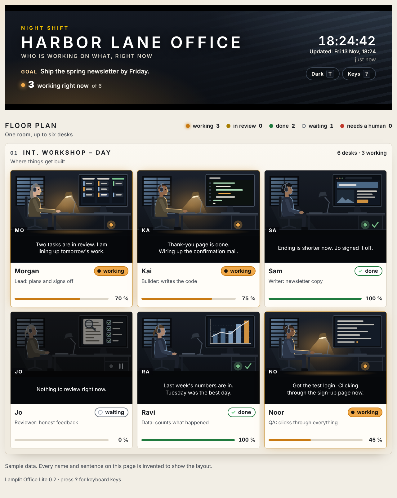
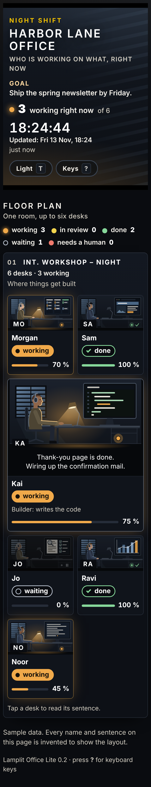

# Lamplit Office Lite

**A status wall for a small team of AI agents, drawn as a little office: one desk, one status and one sentence per agent.**
For people who run a handful of agents and want one page they can show to someone who does not read terminals.
**Live demo** (full version, sample data): https://zato.org/office-demo/



One HTML file and one small data file. No server, no build step, no dependencies, no tracking. MIT.
All names and sentences in the pictures are invented sample data.

## Quick start in 60 seconds

1. Click **Code → Download ZIP** and unpack it.
2. Double-click `index.html`. The sample office appears.
3. Open `office-data.js` in a text editor, change a name or a sentence, save. The page picks it up within 30 seconds (press `R` to read it at once).

Prefer a list? Keep your team in a spreadsheet export or a JSON file and let the included script write the data file (Python 3.8 or newer, no extra packages):

```
python3 update_office.py team.sample.csv
python3 update_office.py team.sample.csv --watch     # rewrites whenever you save the list
```

## What it does not do

- **It does not hook into agents by itself.** The page only shows what is written in `office-data.js`. You, a script or your agents write that file.
- **It is not a tracing or monitoring tool.** No token counts, no logs, no alerts.
- **It is not real time.** The page re-reads the data file every 5 seconds at the fastest.
- **There is no login.** Whoever can open the page can read the data file. Keep secrets out of it.

## Screenshots

| Dark (default) | Light | Phone |
|---|---|---|
|  |  |  |

## Data format

`office-data.js` sets `window.OFFICE`. Plain JSON works too.

```js
window.OFFICE = {
  "title": "Harbor Lane Office",
  "goal": "Ship the spring newsletter by Friday.",
  "updated": "2030-01-15T14:05:00+01:00",
  "refreshSeconds": 30,
  "theme": "dark",
  "room": { "title": "Workshop", "note": "Where things get built" },
  "team": [
    { "code": "KA", "name": "Kai", "role": "Builder: writes the code", "desk": "terminal",
      "status": "working", "progress": 40, "says": "The sign-up form works. Now the thank-you page." }
  ]
};
```

| Field | Meaning |
|---|---|
| `title`, `kicker`, `subtitle` | The big title in the header and the small lines around it. |
| `goal` | One sentence: what the team is working towards. |
| `updated` | When the file was written (ISO date and time). The header shows how old the data is. |
| `refreshSeconds` | How often the page re-reads the file. 5 to 3600, default 30. |
| `theme` | Colours the page starts with: `dark` (default), `light` or `auto` (follows the device). |
| `room` | `{ title, note }` for the one room. |
| `team` | Up to six members, see below. |
| `note` | Small print at the bottom. |

One team member:

| Field | Meaning |
|---|---|
| `name` | Name on the desk. The only required field. |
| `code` | 2 to 4 letters on the desk. Also decides the look of the figure. |
| `role` | One short line. |
| `desk` | What stands on the desk: `board`, `review`, `browser`, `terminal`, `chart`, `notes`. |
| `status` | `working`, `waiting`, `done`, `review` or `blocked`. |
| `progress` | 0 to 100. |
| `says` | One sentence, shown like a film subtitle. |
| `started`, `minutes` | Optional. While the status is `working`, the bar then moves by itself. |

## Updating it from a list

`update_office.py` turns a CSV or JSON list into `office-data.js`. It writes the file in one step, so the page never reads a half-written file. It never changes your list.

```
python3 update_office.py team.csv --title "My agents" --goal "Ship v2 by Friday"
python3 update_office.py team.json --watch
python3 update_office.py team.csv --history log     # also keeps a time-stamped copy in ./log
python3 update_office.py --help
```

- **CSV:** first line is the header. Columns in any order: `code, name, role, desk, status, progress, says, started, minutes`. Comma or semicolon both work, so a spreadsheet export is fine. See `team.sample.csv`.
- **JSON:** a list of team members, or one object with `team` plus the page fields above. See `team.sample.json`.
- Mistakes in the list (unknown status, a progress that is not a number, more than six members) are reported as warnings in plain words.

To connect your agents, let each agent (or the script that starts them) write its line into the list. `update_example.py` is still included: it shows how to build the data in Python and has a `--simulate` mode with made-up progress for a first look.

## Keyboard and phone

| Key | What it does |
|---|---|
| `Tab` | Next desk or button |
| Arrow keys, `Home`, `End` | Move from desk to desk |
| `1` to `6` | Jump to that desk |
| `Enter` | Open or close a desk (phone layout: shows its sentence) |
| `T` | Light or dark colours (the browser remembers your choice) |
| `R` | Read the data file again now |
| `?` | Show the list of keys |

On a phone the desks stand two in a row. Tap a desk to read its sentence and role.

## How it compares

| | Lamplit Office Lite | Tracing and monitoring tools | A shared text file or chat channel |
|---|---|---|---|
| Hooks into agents by itself | No | Usually yes | No |
| Logs, token counts, alerts | No | Yes | No |
| Setup | Open one HTML file | Install, connect, configure | None |
| Readable for non-technical people | Yes, that is the point | Rarely | Sometimes |
| Shows more than a status and a sentence | No | Yes | Whatever you type |

If you need to debug agents, use a tracing tool. If you want automatic tracking of coding-agent sessions on your own machine, the open-source pixel-office projects do that well. This page is for a different job: showing a small team's status at a glance.

## FAQ

**Does it work without a web server?** Yes. Double-click `index.html`. It also works from any static web space or GitHub Pages.

**How do my agents get onto the page?** They do not appear by themselves. Something has to write `office-data.js`: you by hand, `update_office.py` from a list, or your own code.

**Can I have more than six desks or several rooms?** Not in Lite. The page shows the first six members and says so at the bottom.

**Does it send data anywhere?** No. Nothing is loaded from the internet and nothing is sent. Your light/dark choice is stored in your own browser.

**Can I put it on a wall screen?** Yes. It re-reads the data by itself and needs no clicks.

**Which browsers?** Tested in Chrome 153 (desktop and phone widths from 320 px). Firefox and Safari are not tested yet. Reports are welcome in the issues.

**Is the text in the data file safe to show?** Text is shown as text; HTML in it is not run. Still, do not put passwords or keys into the file.

## Good to know

- Works offline. No fonts, scripts or pictures are loaded from the internet.
- The page respects the "reduce motion" setting of the device.
- In the light colours the film header and the desk pictures stay dark on purpose.
- Some names inside the code are short and not in English. The comments are in English.
- Changes are listed in `CHANGELOG.md`.

## Licence

MIT, see `LICENSE`.

Built with AI assistance.

## Full version

This repository is the free basic version: one room, up to six desks. A paid full template (19 €, one payment, no subscription) adds several rooms, a detail panel for every agent, a team chat, an activity log and more desk props: https://payhip.com/b/jyk8v
