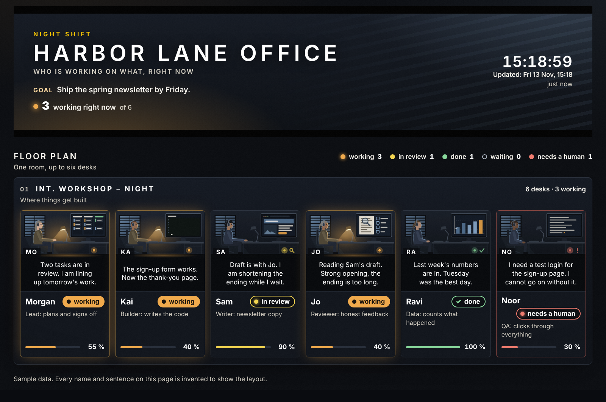

# Lamplit Office Lite

A film-style status wall for a small team of AI agents. One HTML file, one small data file.
No server, no build step, no dependencies, no tracking.



Every agent gets a desk, a role, a status and one sentence about what it is doing right now.
A lit desk means working. A dim desk means waiting. A red light means the agent needs a human.

All names and sentences in the screenshot are invented sample data.

## What it is not

- **It does not connect to your agents by itself.** The page only shows what is written in `office-data.js`. You, a script or your agents write that file.
- **It is not a tracing or monitoring tool.** No token counts, no logs, no alerts.
- **It is not real time.** The page re-reads the data file every 5 seconds at the fastest.
- **There is no login.** Whoever can open the page can read the data file. Keep secrets out of it.

If you want automatic tracking of coding-agent sessions on your own machine, the open-source pixel-office projects do that well. This one is for a different job: a page you can show to people who do not read terminals.

## Try it

1. Download `index.html` and `office-data.js` into the same folder (or use "Code" → "Download ZIP").
2. Double-click `index.html`. The sample office appears.
3. Open `office-data.js` in a text editor, change a name or a sentence, save. The page picks it up within 30 seconds.

A live demo of this Lite version is linked in the "About" box of this repository.

## The data file

`office-data.js` sets `window.OFFICE`. Plain JSON works too.

| Field | Meaning |
|---|---|
| `title`, `kicker`, `subtitle` | The film title in the header and the small lines around it. |
| `goal` | One sentence: what the team is working towards. |
| `updated` | When the file was written (ISO date and time). The header shows how old the data is. |
| `refreshSeconds` | How often the page re-reads the file. 5 to 3600, default 30. |
| `room` | `{ title, note }` for the one room. |
| `team` | Up to six members, see below. |
| `note` | Small print at the bottom. |

One team member:

| Field | Meaning |
|---|---|
| `name` | Name on the desk. |
| `code` | 2 to 4 letters on the desk. Also decides the look of the figure. |
| `role` | One short line. |
| `desk` | What stands on the desk: `board`, `review`, `browser`, `terminal`, `chart`, `notes`. |
| `status` | `working`, `waiting`, `done`, `review` or `blocked`. |
| `progress` | 0 to 100. |
| `says` | One sentence, shown like a film subtitle. |
| `started`, `minutes` | Optional. While the status is `working`, the bar then moves by itself. |

## Updating it

By hand: edit `office-data.js` and save.

By script: let a script overwrite `office-data.js`. The included example needs Python 3.8 or newer and no extra packages:

```
python3 update_example.py              # writes the file once
python3 update_example.py --simulate   # made-up progress every 5 seconds
```

To connect your own agents, replace the function `status_from_my_agents()` in `update_example.py`.
The script writes the file in one step, so the page never reads a half-written file.

## Full version

This repository is the free basic version: one room, up to six desks.

The full template adds several rooms, a click-to-open detail panel for every agent (task, latest result, review feedback), a team chat, an activity log, number tiles, a round progress gauge, 22 desk props, your own status words and an office dog. It is a paid download (one payment, no subscription): https://payhip.com/b/jyk8v

Live demo of the full version with sample data: https://zato.org/office-demo/

## Good to know

- Works offline. No fonts, scripts or pictures are loaded from the internet.
- Text from the data file is shown as text. HTML in it is not run.
- The page respects the "reduce motion" setting of the device.
- Some names inside the code are short and not in English. The comments are in English.
- Tested in a current Chrome on desktop and at phone width. Other browsers are not tested yet.

## Licence

MIT, see `LICENSE`.

Built with AI assistance.
